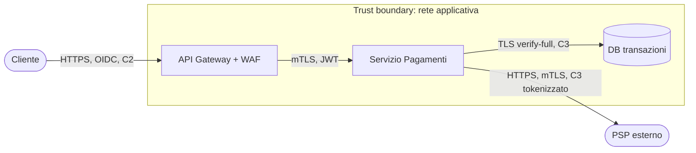

# Threat modeling

Il threat modeling è il momento in cui la sicurezza costa meno: una contromisura decisa in fase di design
costa una riga di specifica, la stessa scoperta in produzione costa un incidente. Lo scopo non è produrre un
documento ma rispondere a quattro domande e lasciare traccia delle risposte:

1. **Su cosa stiamo lavorando?** Componenti, flussi di dati, trust boundary, dati e classificazione.
2. **Cosa può andare storto?** Minacce, per elemento e per flusso.
3. **Cosa facciamo al riguardo?** Contromisure, ciascuna collegata a un controllo SBD e a una verifica.
4. **Abbiamo fatto un buon lavoro?** Ogni minaccia rilevante ha una mitigazione testata o un rischio accettato.

## Regole

**SBD-TM-01 — Threat model light per ogni cambiamento.** Va nel PR, nella sezione *Security Evidence*.
Bastano poche righe se il cambiamento è piccolo, ma le domande vanno poste ogni volta.

**SBD-TM-02 — Threat model full quando scatta almeno un trigger:**
- nuovo servizio, applicazione o componente deployabile;
- nuova esposizione verso Internet, partner o terze parti, o nuovo webhook;
- nuovo flusso che coinvolge dati C3, `PCI-*`, `PII-SPECIAL`, o dati personali verso nuovi destinatari;
- modifica di autenticazione, sessioni, autorizzazione, multi-tenancy, gestione chiavi;
- nuova integrazione con un fornitore esterno, SaaS o modello LLM;
- funzionalità che muove denaro o modifica dati finanziari (pagamenti, rimborsi, payout, limiti).

Il threat model full si salva in `docs/security/threat-models/<componente>.md` con il template in
`references/threat-model-template.md` e va revisionato dal Security Champion. Per i trigger su dati C3,
pagamenti, autenticazione o nuove esposizioni pubbliche serve anche la revisione di Security Engineering.

**SBD-TM-03 — Ogni minaccia ha un esito.** Per ogni minaccia con rischio Medium o superiore indica la
contromisura, la regola SBD che la implementa e la verifica che la dimostra (test, policy, scansione).
In alternativa registra il rischio residuo con owner. Non lasciare minacce "da valutare".

**SBD-TM-04 — Abuse case per la logica di business.** Gli scanner non trovano gli errori di logica: per ogni
funzionalità che sposta valore o cambia stato chiediti come la userebbe un utente malintenzionato
autenticato, non solo un attaccante esterno.

**SBD-TM-05 — Minacce privacy quando ci sono dati personali.** Applica LINDDUN oltre a STRIDE (vedi sotto).
Se emergono trattamenti ad alto rischio, il DPO valuta la necessità di una DPIA (`sbd-data-protection`, SBD-DATA-17).

**SBD-TM-06 — Il threat model segue il codice.** Quando cambia l'architettura, un flusso o la classificazione dei
dati, aggiorna il threat model nello stesso PR. Un threat model non aggiornato dà falsa sicurezza.

## Procedura

### 1. Modella il sistema

Disegna un diagramma di flusso dei dati (DFD) in Mermaid dentro il documento: entità esterne, processi,
data store, flussi, e **trust boundary** (Internet ↔ edge, edge ↔ servizi, servizi ↔ dati, tenant ↔ tenant,
tuo sistema ↔ fornitore). Annota ogni flusso con protocollo, autenticazione e classificazione dei dati.



### 2. Trova le minacce con STRIDE

Applica STRIDE a ogni elemento e a ogni flusso che attraversa un trust boundary.

| Minaccia | Domanda | Contromisure tipiche |
|---|---|---|
| **S**poofing | Qualcuno può fingersi un utente, un servizio o un sistema? | Autenticazione forte, MFA, mTLS, firma dei webhook (SBD-CODE-07, -08) |
| **T**ampering | Qualcuno può modificare dati, messaggi, codice o configurazione? | Validazione, integrità (HMAC, firme), TLS, immutabilità degli artefatti (SBD-CODE-01, SBD-SC-10) |
| **R**epudiation | Qualcuno può negare di aver compiuto un'azione? | Log di audit con identità, timestamp, correlazione; log immutabili (SBD-CODE-15, SBD-INFRA-20) |
| **I**nformation disclosure | Quali dati possono uscire, e verso chi? | Autorizzazione object-level, cifratura, minimizzazione, error handling (SBD-CODE-09, -14, SBD-DATA-04) |
| **D**enial of service | Cosa si può esaurire: CPU, memoria, connessioni, quote, budget? | Limiti, timeout, rate limiting, paginazione (SBD-CODE-17, SBD-INFRA-23) |
| **E**levation of privilege | Un utente può ottenere permessi che non ha? | Deny by default, controlli server-side, least privilege (SBD-CODE-09, SBD-INFRA-04) |

### 3. Minacce privacy con LINDDUN (se ci sono dati personali)

| Minaccia | Domanda |
|---|---|
| **L**inking | Si possono collegare dati di contesti diversi alla stessa persona? |
| **I**dentifying | Si può identificare una persona da dati che dovrebbero essere anonimi o pseudonimi? |
| **N**on-repudiation (indesiderata) | L'interessato è esposto a conseguenze per azioni che non dovrebbe dover dimostrare? |
| **D**etecting | Si può dedurre che una persona usa il servizio o è presente in un dataset? |
| **D**ata disclosure | Si raccolgono, conservano o condividono più dati del necessario? |
| **U**nawareness | L'interessato sa cosa succede ai suoi dati e può esercitare i suoi diritti? |
| **N**on-compliance | Il trattamento rispetta finalità, base giuridica, retention e trasferimenti? |

### 4. Abuse case di business logic

Domande da porsi sempre per funzionalità che muovono valore:

- **Importi e prezzi**: il client può influenzare importo, valuta, sconto, commissione o quantità? Tutto va
  ricalcolato server-side.
- **Replay e doppia esecuzione**: cosa succede se la stessa richiesta arriva due volte, o in parallelo?
  Servono chiavi di idempotenza e vincoli transazionali.
- **Race condition**: due operazioni concorrenti possono superare un limite o un saldo?
- **Sequenza di stati**: si può saltare un passo (pagare senza autorizzazione, rimborsare senza acquisto,
  confermare senza OTP)? La macchina a stati va imposta server-side.
- **Enumerazione**: si possono scoprire account, carte, IBAN, ID di ordini o codici promozionali per tentativi?
- **Limiti e velocity**: un utente può aggirare soglie giornaliere frazionando le operazioni?
- **Abuso di funzioni legittime**: rimborsi, chargeback, inviti, referral, cambio email/telefono, recupero
  account, export di dati.
- **Confusione di tenant o merchant**: un merchant può operare su risorse di un altro cambiando un ID?

### 5. Catalogo rapido per tipo di componente

| Componente | Minacce da verificare sempre |
|---|---|
| Frontend web | XSS, CSRF, clickjacking, script di terze parti, token nel browser, open redirect |
| API REST/GraphQL | BOLA/IDOR, BFLA, mass assignment, injection, rate limiting, introspection GraphQL, query depth |
| Consumer di code/eventi | Messaggi falsificati o malformati, replay, poison message, ordine non garantito |
| Job batch | Credenziali a lungo termine, input da file non validati, mancata idempotenza |
| Database | Accesso eccessivo dell'account applicativo, dati non cifrati, backup esposti, injection |
| Object storage | Bucket pubblici, URL firmati a lunga durata, upload malevoli, mancata cifratura |
| Integrazione con terzi | Risposte non validate, TLS non verificato, segreti condivisi statici, SSRF, dipendenza da disponibilità |
| Console amministrativa | Esposizione su Internet, assenza di MFA, azioni senza audit, privilegi eccessivi |
| Pipeline CI/CD | Injection da PR esterne, segreti esposti, action compromesse, artefatti non firmati |
| Componente LLM | Prompt injection, output non validato, agency eccessiva, leakage di dati (vedi `sbd-ai-security`) |

### 6. Valuta e decidi

Stima per ogni minaccia probabilità (Bassa/Media/Alta) e impatto (Basso/Medio/Alto/Critico) e ricava il
rischio con la matrice del template. Poi decidi: **mitigare** (default), **eliminare** (rimuovere la
funzionalità o il dato), **trasferire** (solo con contratto e controllo del fornitore), **accettare** (solo
con eccezione formale, vedi `sbd-core/references/policy-parameters.md`).

## Formato del threat model light (nel PR)

```markdown
### Threat model (light)
- Cambiamento: <una frase>
- Superficie esposta: <nessuna nuova | endpoint X pubblico | ...>
- Dati toccati: <entità, classificazione, etichette>
- Trust boundary attraversati: <...>
- Minacce principali e contromisure:
  - <minaccia STRIDE> → <contromisura> (<ID regola>) — verificata da <test/scansione>
- Abuse case considerati: <...>
- Trigger per threat model full: <nessuno | elenco → link al documento>
- Rischi residui: <nessuno | descrizione, owner>
```

## Riferimenti

- `references/threat-model-template.md` — template completo del threat model full con matrice di rischio.
  Leggilo quando scatta un trigger di SBD-TM-02.
